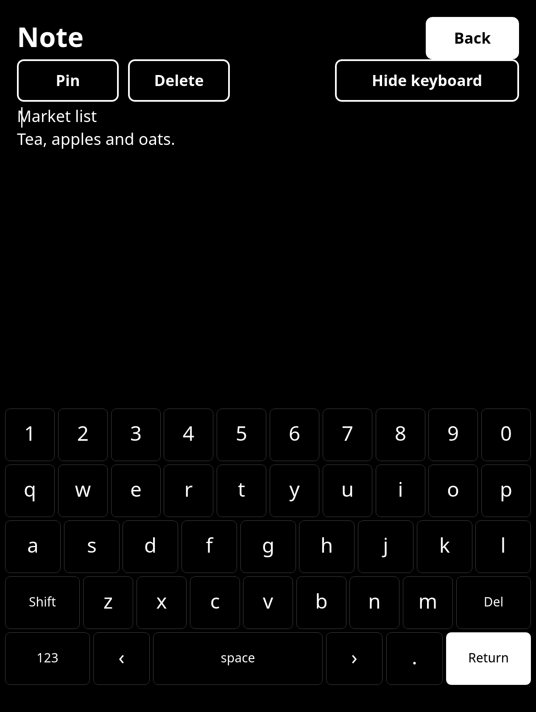
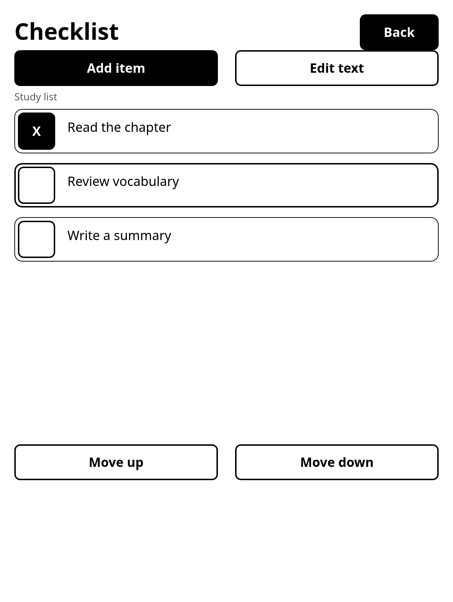
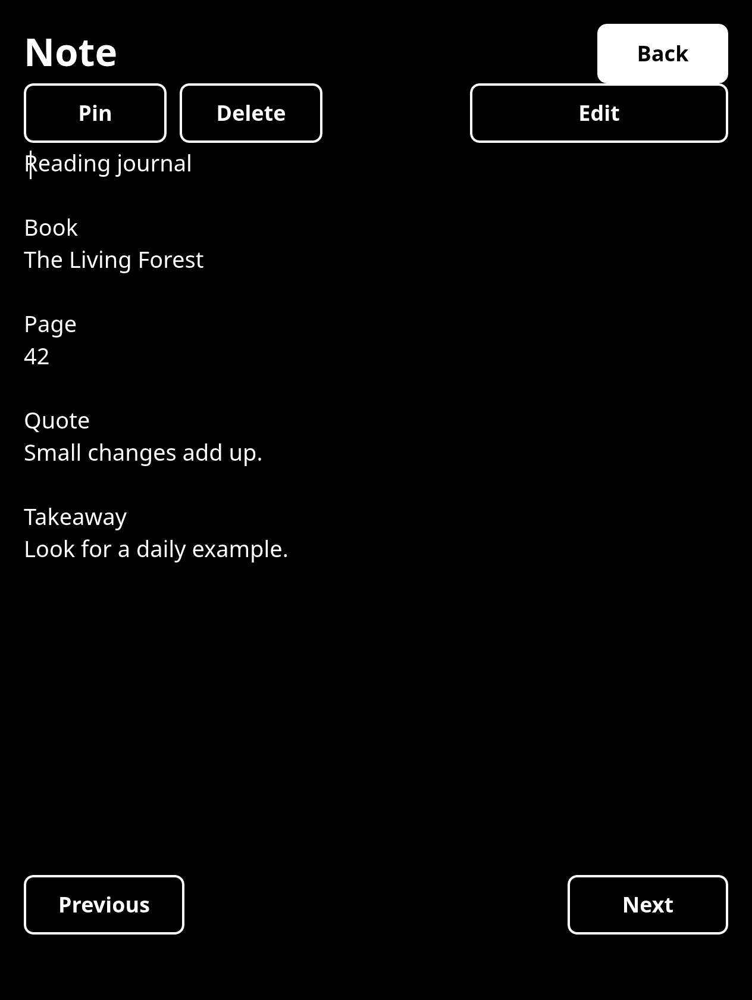

<div align="center">

# Notes

**Plain-text notes and checklists**

[](https://github.com/PrimitiveOS/kindle-primitive-notes/actions/workflows/ci.yml)
[](https://github.com/PrimitiveOS/kindle-primitive-notes/releases)
[](https://github.com/PrimitiveOS/kindle-primitive-notes/tags)
[](LICENSE)
[](https://github.com/PrimitiveOS/kindle-primitive-notes/stargazers)
[](https://primitiveos.github.io/kindle-primitive-catalog/v1/index.json)

[**Download**](https://github.com/PrimitiveOS/kindle-primitive-notes/releases/latest) · [**Install guide**](INSTALL.md) · [**Changelog**](CHANGELOG.md)

</div>

---

Write, pin, and search plain-text notes. Check items off and reorder them in Checklist view, or start a reading journal from Templates. Your notes stay as UTF-8 text files.

## Quick start

After setting up PrimitiveOS, open **Store** from Primitive Launcher. Choose **Notes** under **Apps**,
tap **Get**, and open it from the Launcher grid. The [install guide](INSTALL.md) also covers the standalone USB package.

## Screenshots

<table>
  <tr>
    <td align="center"><br><sub>Notes list and search</sub></td>
    <td align="center"><br><sub>Editing a note</sub></td>
    <td align="center"><br><sub>Dark mode</sub></td>
  </tr>
  <tr>
    <td align="center"></td>
    <td align="center"></td>
  </tr>
</table>

<sub>Desktop simulation at 1264 × 1680 with sample notes.</sub>

## Highlights

- The first nonempty line becomes the title. Pinned notes appear above the newest notes.
- Every edit is saved. Delete offers Undo from the notes list.
- With a matching Launcher, Notes refreshes the folder after USB eject and preserves conflicting drafts as separate notes.

## Develop locally

Keep `doannt-kindle-tools` and `doannt-kindle-launcher` next to this checkout. The desktop command writes sample PNGs
to `build/previews`.

```sh
cargo test --offline --locked --workspace
cargo run --offline --locked -p notes-desktop -- build/previews
```

## Status

| Device | Status |
|---|---|
| Kindle Oasis 3 (1264 × 1680, firmware 5.18.2) | Tested on hardware |

**Current version: 0.1.2.** Changes are in [CHANGELOG.md](CHANGELOG.md).

## Downloads

The badge at the top shows the number of Store downloads. It counts GitHub downloads of this app's release packages, across all versions and architectures, and is refreshed daily from the [Store catalog](https://primitiveos.github.io/kindle-primitive-catalog/v1/index.json).

## Documentation

[Install guide](INSTALL.md) · [Changelog](CHANGELOG.md) · [Device notes](docs/device-notes.md)

## Licence

Copyright (C) 2026 Doan Nguyen.

App code is licensed under PolyForm Noncommercial 1.0.0. [Code license](LICENSE)

Original documentation and screenshots are licensed under Creative Commons Attribution-NonCommercial-ShareAlike 4.0
International (CC BY-NC-SA 4.0). [Documentation and image license](LICENSE-DOCS)
