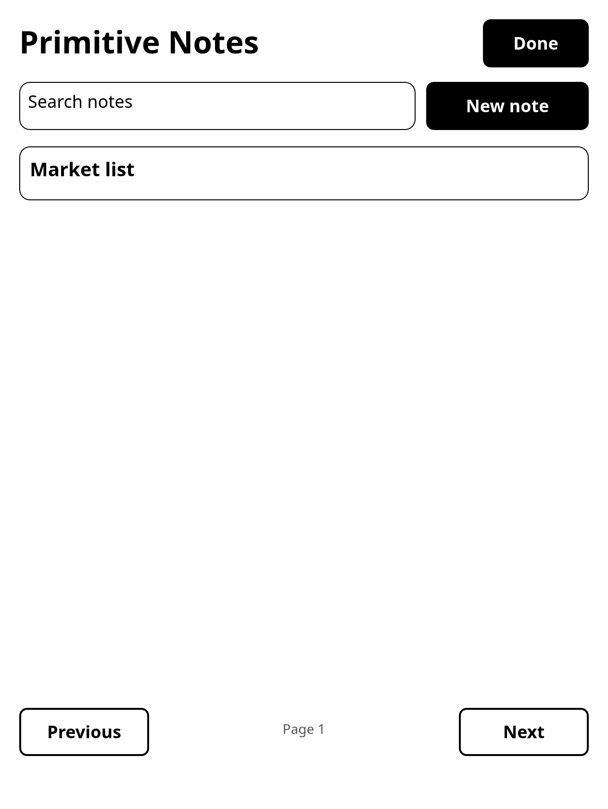
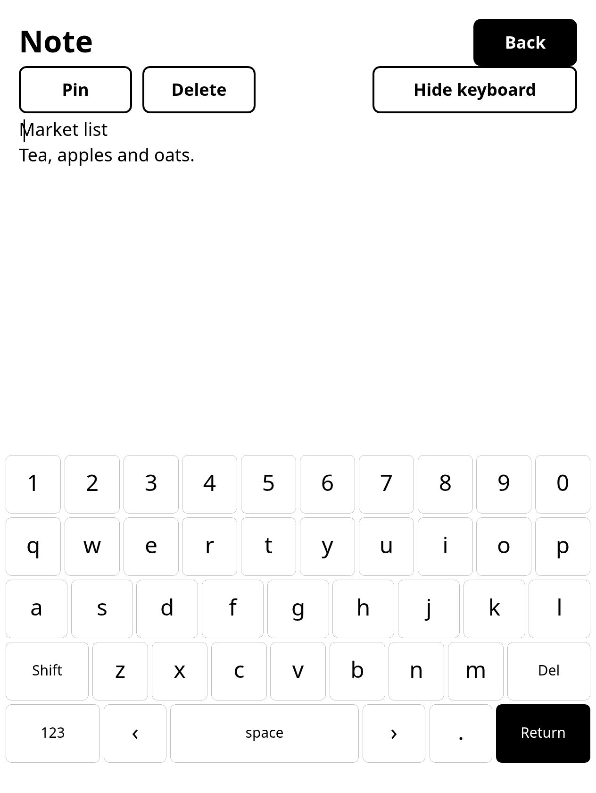

<div align="center">

# Primitive Notes

**A plain-text notebook for Kindle e-readers.**

[Install guide](INSTALL.md) · [Device notes](docs/device-notes.md) · [Changelog](CHANGELOG.md)

</div>

---

Write notes with the on-screen keyboard, search their contents, and pin the ones you use most. Each note is stored as
a UTF-8 text file in `/mnt/us/notes/`, ready to copy over USB.

## Screenshots

<table>
  <tr>
    <td align="center"><br><sub>Notes list and search</sub></td>
    <td align="center"><br><sub>Editing a note</sub></td>
    <td align="center"><br><sub>Dark mode</sub></td>
  </tr>
</table>

<sub>Desktop simulation at 1264 × 1680 with sample notes.</sub>

## Highlights

- The first nonempty line becomes the title. Pinned notes appear above the newest notes.
- Every edit is saved. Delete offers Undo from the notes list.
- With a matching Launcher, Notes refreshes the folder after USB eject and preserves conflicting drafts as separate notes.

## Quick start

Copy the `notes` and `documents` folders from the local ARMHF package to your Kindle over USB, then eject and open
**Primitive Notes** from Primitive Launcher. The app uses the fonts installed by Launcher. [Install guide](INSTALL.md)

## Status

Desktop simulation and local ARMHF package checks passed on the Mac. Oasis 3 testing, including USB eject and sleep
and wake, is pending. [Device notes](docs/device-notes.md)

## Develop locally

Keep `doannt-kindle-tools` and `doannt-kindle-launcher` next to this checkout. The desktop command writes sample PNGs
to `build/previews`.

```sh
cargo test --offline --locked --workspace
cargo run --offline --locked -p notes-desktop -- build/previews
```

## Licence

Copyright (C) 2026 Doan Nguyen.

App code is licensed under PolyForm Noncommercial 1.0.0. [Code license](LICENSE)

Original documentation and screenshots are licensed under Creative Commons Attribution-NonCommercial-ShareAlike 4.0
International (CC BY-NC-SA 4.0). [Documentation and image license](LICENSE-DOCS)
